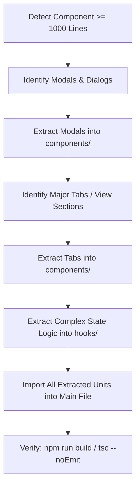

# React Component Size & Modularization Refactoring Skill

This skill enforces modularity, maintainability, and clean component architecture across all React / TypeScript frontend code in `my-tools-react`.

---

## 1. The 1000-Line Component Rule

> [!IMPORTANT]
> **Trigger Condition**: When any React component or frontend file (`.tsx` or `.ts`) reaches or exceeds **1000 lines**, it **must** be refactored by extracting subcomponents, modals, views, tabs, or custom hooks into separate files and importing them back.

### Why 1000 Lines?
A single React file with > 1000 lines is a classic monolithic component code smell. It typically indicates:
- Multiple tabs or views crammed into a single file with complex conditional rendering (`activeTab === ...`).
- Multiple modal dialogs defined inline inside the parent component.
- Giant JSX trees that mix player bars, tables, headers, forms, and dialogs.
- Massive state declarations with dozens of `useState` / `useEffect` hooks that could be encapsulated in custom hooks.

---

## 2. Extraction Targets: What to Separate

When a React file approaches or exceeds 1000 lines, decompose it into the following focused pieces:

### A. Modals & Dialogs (Immediate First Target)
Extract every modal into its own file under `components/`:
- **Examples**: `EditTrackModal.tsx`, `CreateAlbumModal.tsx`, `ImportZipModal.tsx`, `ConfirmDeleteModal.tsx`.
- **Props interface**: Define clean props:
  ```tsx
  interface EditTrackModalProps {
    isOpen: boolean;
    track: AudioTrack | null;
    onClose: () => void;
    onSave: (updated: UpdateTrackRequest) => Promise<void>;
  }
  ```
- **Benefit**: Instantly removes 150–300 lines of modal markup and local form state from the parent file.

### B. Tab Views & Major Sub-Sections
If a page contains multiple tabs (e.g. Albums, Artists, Tracks, Tags, Upload):
- Extract each tab view into its own component:
  - `components/AlbumsTabView.tsx`
  - `components/TracksTabView.tsx`
  - `components/ArtistsTabView.tsx`
  - `components/TagsSyncTabView.tsx`
- The parent container component simply manages `activeTab` and passes data/handlers down.

### C. Reusable Item Rows & Cards
Extract complex repeated items from `.map(...)` blocks:
- **Examples**: `TrackRowItem.tsx`, `AlbumCardItem.tsx`, `ArtistGroupCard.tsx`.
- Keeps the parent list rendering clean and readable (`{tracks.map(t => <TrackRowItem key={t.id} track={t} ... />)}`).

### D. Persistent Footers, Toolbars & Player Bars
If the page has a complex persistent toolbar or player (e.g. audio player bar with seek slider, volume, playlist drawer):
- Extract into `components/AudioPlayerBar.tsx` or `components/MusicSearchBar.tsx`.

### E. Custom Hooks for Complex State & Side Effects
If the parent component has 10+ `useState` calls and multiple `useEffect` fetches:
- Extract state management into custom hooks in a `hooks/` subfolder:
  - `hooks/useAudioPlayer.ts`: handles `<audio>` element ref, play/pause, time update, volume, next/prev.
  - `hooks/useMusicLibrary.ts`: handles fetching albums, summary, search filters, reload trigger.

---

## 3. Recommended Directory Structure

For any page or feature module undergoing decomposition, organize files as follows:

```text
src/pages/streaming-platform/music/
├── MusicPage.tsx                # Main container / coordinator (< 1000 lines)
├── MusicPage.module.css         # Page-level styles
├── types.ts                     # Domain interfaces & request/response types
├── components/                  # Extracted child components
│   ├── AlbumsTabView.tsx
│   ├── TracksTabView.tsx
│   ├── ArtistsTabView.tsx
│   ├── EditTrackModal.tsx
│   ├── CreateAlbumModal.tsx
│   ├── ImportZipModal.tsx
│   ├── AudioPlayerBar.tsx
│   └── TrackRowItem.tsx
└── hooks/                       # Extracted custom hooks
    ├── useAudioPlayer.ts
    └── useMusicLibrary.ts
```

---

## 4. Step-by-Step Refactoring Process



1. **Step 1: Extract Modals**:
   - Cut modal JSX and local form state out of the parent.
   - Create `components/[ModalName].tsx`.
   - Define TypeScript props interface (`isOpen`, `onClose`, `onSubmit`, data props).
   - Import and render `<ModalName ... />` in the parent.

2. **Step 2: Extract Tab Views**:
   - Move tab-specific render branches into `components/[TabName]View.tsx`.
   - Pass filtered data and action callbacks via props.

3. **Step 3: Extract Persistent Bars / Toolbars**:
   - Move fixed player or filter bars into dedicated subcomponents.

4. **Step 4: Verify TypeScript & Build**:
   - Run `npx tsc --noEmit` or `npm run build` from `my-tools-react/` to ensure zero type errors or broken prop bindings.

---

## 5. Refactoring Checklist

Before completing frontend changes:
- [ ] No single `.tsx` file exceeds 1000 lines.
- [ ] Extracted components reside in a co-located `components/` directory.
- [ ] Each extracted component has an explicit, typed TypeScript `interface Props`.
- [ ] Modals and tabs are clean, isolated components with their own localized state where appropriate.
- [ ] Styles use CSS modules (`.module.css`) or shared design variables (`src/styles/variables.css`).
- [ ] Application builds without compilation errors (`npm run build` or `npx tsc --noEmit`).
